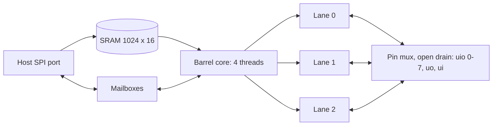

# Tempo

Tempo is a programmable protocol emulator for the [Jane Street ASIC
competition](https://blog.janestreet.com/protocol-emulator-asic-competition/):
IHP 130 nm CMOS5L, 6x4 Tiny Tapeout tiles. Protocols are firmware. The chip
has no UART, SPI or I2C block.

## The idea

Bit-banging has two jobs that pull in different directions. Deciding what to
send is ordinary computation and is rarely urgent. Deciding when a pin moves
must be exact to the cycle. Tempo splits them:

- **Threads compute.** Four threads share one 16-bit datapath in strict
  rotation and one 1024-word SRAM. A thread runs one instruction every four
  cycles, always in the same cycle slot, so no thread can disturb another's
  timing.
- **Lanes keep time.** Three lanes each own up to four pins and a timeline.
  A thread hands a lane a word, a bit count and optionally a start time. The
  lane shifts it out or in on a fractional bit period, drives the clock pin,
  samples at a set offset, and can apply NRZI, bit stuffing and CRC (lanes 0
  and 1). Each bit is drawn as a programmable two-level symbol, so the line
  code is a register setting.



RP2040 PIO gives four state machines one shared 32-instruction memory, each with a shifter pair and a
clock divider; anything stateful (stuffing, CRC, arbitration, a second
protocol) needs the CPU beside it. TI PRU is a full RISC core that times pins
by counting its own instructions. Tempo keeps the program in one shared store,
moves bit timing and line coding out of the instruction stream, and lets a
thread queue work ahead of the wire. The cost is speed: the core clock is
lower than either, and a lane does only what its registers describe. A lane
UART costs 5 thread instructions per byte where a PRU-style software loop on
the same core costs 49, and its edges do not move when other threads are busy
([measurements](docs/verification.md#measured-benefit-of-lanes)).

## Protocols

Each row is firmware in [fw/](fw/) checked against a wire model written from
the protocol specification ([tools/tempo/models/](tools/tempo/models/)).

<!-- protocols:begin -->
<!-- protocols:end -->

`fw/demo_multibus.s` runs UART, Manchester and an I2C controller with clock
stretching at the same time from one 130-word image. Not supported: 10BASE-T
(pad speed), USB enumeration (the USB test is packet level), CAN receive,
PS/2 host-to-device commands.

The host library ([host/tempo_host/](host/tempo_host/)) turns the same chip
into bench tools: I2C scan and dump, SPI flash read and program, JTAG chain
scan and pin finder, SWD attach, UART autobaud, logic analyser, I2C and SPI
bus monitors, a 24C02 EEPROM target and a triggered pulse generator.

## Results

<!-- results:begin -->
<!-- results:end -->

## Build and test

Needs Icarus Verilog and Python 3.11.

```sh
python3 -m venv .venv && source .venv/bin/activate
pip install -r test/requirements.txt
(cd tools && python -m pytest -q tests/)      # firmware and host library on the model
(cd test && make -B)                           # the same on the RTL, in lockstep with the model
(cd test && make -B COCOTB_TEST_MODULES=test_random RAND_SEEDS=100)
python tools/tests/test_cli.py i2c             # an I2C scan on the simulated chip
```

The GDS is built by the `gds` workflow (Tiny Tapeout action, LibreLane).
Formal jobs are in [formal/](formal/) (`sby -f core.sby`).

## Documents

- [docs/info.md](docs/info.md): pins, host commands, first program.
- [docs/architecture.md](docs/architecture.md): ISA, lanes, timing model, comparison with PIO and PRU.
- [docs/verification.md](docs/verification.md): method, results, bugs caught, gaps.
- [docs/decisions.md](docs/decisions.md): design decisions and what was rejected.

Apache-2.0, see [LICENSE](LICENSE).
